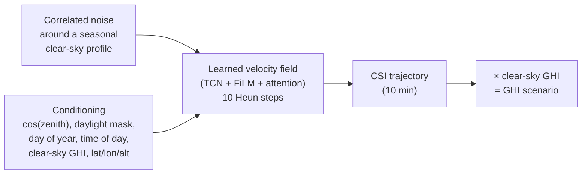
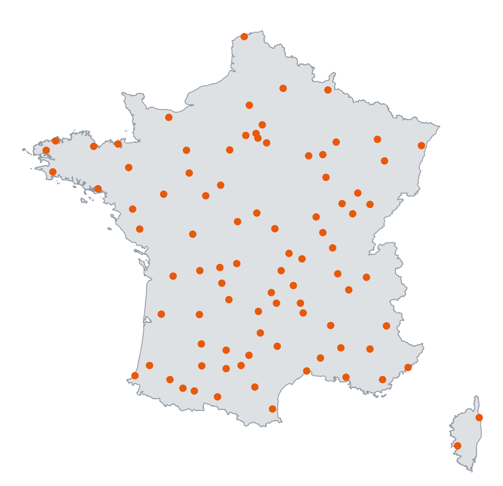

<div align="center">

# SolFlow.gen

### Conditional flow matching for probabilistic solar irradiance scenario generation

*Whole-day clear-sky-index trajectories, generated from solar geometry and site coordinates alone.*

<p>
  
  
  
  <a href="https://solflow-gen.streamlit.app/"></a>
  
  
  <a href="LICENSE"></a>
</p>

[**Overview**](#overview) · [**Live app**](#live-app) · [**Quick start**](#quick-start) · [**How it works**](#how-it-works) · [**Results**](#results) · [**Stations**](#stations) · [**Citation**](#citation) · [**License**](#license) · [**Contact**](#contact)

</div>

---

## Overview

Studies of storage sizing and grid ramp-rate limits need irradiance days that reproduce not only the distribution of values but also their order in time.

SolFlow is a flow-matching model that generates ensembles of complete daily trajectories of the clear-sky index (CSI) and converts them to GHI. No measurements and no weather forecast are needed at generation time.

| | |
|---|---|
| **Full-day trajectories** | Not just a mean or a set of quantiles: the samples keep realistic temporal structure (ramps, autocorrelation, roughness). |
| **Physics-aware conditioning** | Solar geometry, calendar date, clear-sky GHI and site position (latitude, longitude, altitude). |
| **Generalises to new sites** | Evaluated on 40 stations never seen during training, on a year never seen either. |
| **Interactive app** | Pick a point, a date range and an ensemble size, then plot, inspect and download the samples. |

## Live app

The model is available as a Streamlit app, no installation required:

<div align="center">

[](https://solflow-gen.streamlit.app/)

</div>

> **Note:** The app is hosted on Streamlit Community Cloud and goes to sleep after a period of inactivity. If you see a *"This app has gone to sleep due to inactivity"* page, click **"Yes, get this app back up!"** and wait a minute or so for it to wake up.

## Quick start

To run the app locally:

```bash
python -m pip install torch numpy pandas streamlit plotly pvlib
cd streamlit_app
python -m streamlit run app.py
```

> [!IMPORTANT]
> Start the app from **inside `streamlit_app/`**, which holds the app theme. The four trained checkpoints are in `streamlit_app/checkpoints/`.

> [!TIP]
> The checkpoints were trained with **McClear** (CAMS) clear-sky irradiance. The app draws its own clear-sky curve with **Ineichen** (pvlib, default) to scale CSI into GHI. You can train, fine-tune or plot with any clear-sky model, but choose one close to the one used for training.

## How it works



| Component | Details |
|---|---|
| **Method** | Conditional flow matching, integrated with 10 Heun steps |
| **Network** | Dilated temporal CNN, FiLM conditioning, one self-attention layer (hidden size 128, 4 heads) |
| **Inputs** | cos(zenith), daylight mask, time of year, position in day, clear-sky GHI, site position. All of them are computed from a date range and coordinates only. |
| **Released weights** | 4 fold checkpoints in `streamlit_app/checkpoints/`, with a Gaussian CSI representation and no sky-regime conditioning |

## Data

| | |
|---|---|
| **Provider** | Météo-France |
| **Stations** | 90 ground stations · lat 41.9–51.0 °N · lon 4.4 °W–9.5 °E · altitude 1–1148 m (median ≈ 140 m) |
| **Measurements** | GHI every minute, aggregated to a 10-min grid; a step is kept if at least 60 % of its minutes are valid |
| **Clear sky** | McClear (CAMS); CSI = GHI / clear-sky GHI |
| **Filters** | zenith < 85°, clear-sky GHI > 50 W/m², CSI ∈ [0.02, 1.8], suspect zeros dropped |

## Training and evaluation protocol

The split is strict in both space and time: test results are on stations and on a year the model has never seen.

| | |
|---|---|
| **Train years** | 2017–2021 |
| **Test year** | 2022 |
| **Folds** | 4 folds, 10 disjoint held-out stations each, so 40 stations are tested |
| **Training stations** | the other 80 in each fold, with one checkpoint per fold |

## Results

SolFlow is benchmarked against **DeepQuantile** (same backbone, pinball loss), whose marginal quantiles are turned into daily trajectories through either **independent coupling** or a **Gaussian temporal copula**. Both models are assessed under Gaussian and logarithmic CSI representations, and the ranking is the same for both.

*Test on 2022 · 10 unseen stations per fold · 4 folds.*

**Marginal accuracy.** The two models are close. Mean pinball loss is 0.070 for SolFlow and 0.068 for DeepQuantile. SolFlow's empirical quantile frequencies stay within 2–3 % of the nominal levels, and it obtains the lowest variogram score.

**Temporal structure.** This is where SolFlow gains the most.

| Metric (lower is better) | **SolFlow** | DeepQuantile + Gaussian copula | DeepQuantile + independent |
|---|:---:|:---:|:---:|
| KS distance, largest daily ramp | **0.07** | 0.24 | 0.79 |
| Autocorrelation error, lags 1–10 (Gaussian) | **0.007** | 0.092 | 0.308 |
| Roughness error | **0.003 – 0.008** | 0.039 | 0.18 |

<div align="center">

| Largest-ramp distance | Autocorrelation error | Roughness error |
|:---:|:---:|:---:|
| **≈ 4× / 12×** larger for baselines | **13× / 45×** larger for baselines | **5–13× / 23–61×** larger for baselines |

</div>

> [!NOTE]
> Sky-regime conditioning lowers the largest-ramp distance further (0.07 → 0.04), at the cost of marginal accuracy and energy score.

## Stations

The 90 Météo-France ground stations are spread across mainland France and Corsica, at altitudes from 1 to 1148 m.

<div align="center">

</div>

## Repository layout

```text
SolFlow.gen/
├── solflow_gen/            # Python package
│   ├── data/               # data loading and preprocessing
│   ├── transforms/         # CSI representations (Gaussian, log)
│   ├── models/             # flow-matching network
│   ├── training/           # training loops
│   └── evaluation/         # metrics and benchmarks
├── configs/                # experiment configurations
├── streamlit_app/
│   ├── .streamlit/         # app theme
│   ├── checkpoints/        # 4 trained fold checkpoints
│   └── ui/                 # app interface components
├── pyproject.toml
├── LICENSE
└── README.md
```

## Citation

The paper is under review. Until it is published, please cite it as:

```bibtex
@unpublished{frimane_solflow,
  author = {Frimane, et al.},
  title  = {Conditional Flow matching for probabilistic solar irradiance scenario generation},
  note   = {Under review}
}
```

## License

Released under the **GNU General Public License v3.0** (GPL-3.0). See [`LICENSE`](LICENSE) for the full text.

## Contact

**Azeddine Frimane**: [Azeddine.frimane@yahoo.com](mailto:Azeddine.frimane@yahoo.com)

Questions, bug reports and collaboration ideas are welcome. Email me or open an issue.
